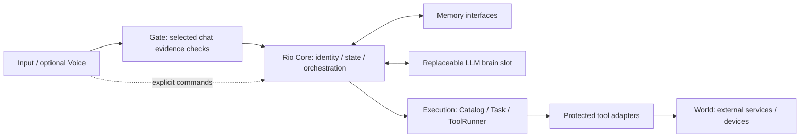

# Rio — v0.1 Architecture Preview

**Rio is the system, not the LLM.**

The model is a replaceable **brain slot**. Rio's application code owns identity configuration, memory access, durable state, policy checks, tool contracts and execution records. Swapping a model does not grant it authority over those components.

**Experimental / not production-ready.** This source preview exposes an existing implementation and an offline demonstration. It is not a ready-to-deploy home controller or a new execution framework. The project license is under review: see the [GPL-3.0 / Apache-2.0 audit](docs/release/v0.1-license-compatibility.md). No license has been selected yet.



The Gate is an evidence-policy interface, not a universal authorization firewall. Explicit tools use their own contract/permission checks. See [actual routing and boundaries](docs/architecture.md).

## Offline quick start

Linux / Python 3.12 is the release-preview reference environment. No model, API key, GPU, Docker, personal NAS, browser session or appliance is required.

```sh
python3 -m venv .venv
. .venv/bin/activate
python -m pip install -r requirements-preview.lock
python examples/offline_demo.py
```

The demo runs the **existing Task / Catalog / ToolRunner / SQLite Store**, executes the read-only `core.status` tool, reopens its private temporary state in a fresh process and prints the same request ID and recorded result. It does not call a model, start services, play audio or send device commands.

A second demonstration reuses an existing crash test with a fake backend:

```sh
python -m pytest -q tests/test_execution_ipc.py::test_actual_process_death_retains_same_key_and_never_resends
```

This tests SIGKILL/recovery and no second dispatch in the mock backend. It does not demonstrate physical-device control or a global exactly-once guarantee.

## What is implemented

- Common tool discovery and bounded argument/revision checks.
- Durable tasks, request IDs, delivery phases, explicit pause/resume/cancel and same-ID result lookup.
- Single-host executor/task fencing and cooperating dispatch locks.
- UNKNOWN handling that holds uncertain effects instead of blindly replaying them.
- Existing model, memory, evidence-gate and optional voice interfaces.

[Execution](docs/execution-core.md) · [Memory](docs/memory.md) · [Gate](docs/gate.md) · [Model adapter](docs/model-adapter.md) · [Security](docs/security-model.md)

## Scope and limitations

Personal configuration, logs, databases, model weights, voice/character assets, Android deployment, unrelated game patches and full dubbing/screen/localization services are excluded. Their absence is deliberate; they are not replaced with fake implementations. Root-level client contracts can still describe optional external services, but those services are not installed or claimed as working by the demo.

The provided NAS deployment scripts are implementation references with example paths, not a portable production installer. Host account separation, external device behavior, speech synthesis, browser sessions, remote memory infrastructure and model quality require separate deployment and validation. **Not implemented:** distributed exactly-once execution, cryptographic proof of evidence truth, a fully sandboxed arbitrary-tool platform and a model-independent natural-language compatibility guarantee.

Core retains hardware/provider-specific guards. One device's unresolved legacy operation can conservatively block other operations in this frozen snapshot; that is a disclosed limitation, not a reason to redesign the executor before release. Public-preview tests do not operate real devices.

## Validation

```sh
python tools/ci/check_syntax.py
python tools/ci/run_tests.py
# Full clean-checkout sequence, including dependencies, demos and audits:
bash tools/ci/release-preview.sh
```

The release gate keeps existing core tests and the existing dependency license checker. Optional Registry Docker probes remain opt-in; the preview never starts a Docker daemon. See [validation and scope](docs/release/validation.md).

## References and release status

The execution design references [Chat On Steroids at 6d2b98a](https://github.com/totec448-spec/chat-on-steroids/tree/6d2b98a61b2125a4bbfff744cc47dd81ea0bedc9/src/main). The Python implementation does not port its Electron/ChatGPT automation or account integration. [Provenance and credits](docs/release/v0.1-third-party-provenance.md) distinguish design references, actual upstream derivatives and dependency terms.

The candidate tag is local and is not a published release. Final license selection and release approval are separate from passing tests. [Release notes](docs/release/v0.1.0-architecture-preview.md).
